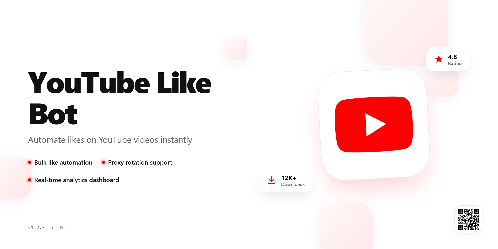

# Friendly YouTube Like Toolkit for Discord & Telegram 👍

### 🚀 PowerShell Quick Install

  

---

Meet the YouTube Like Bot — a friendly, community-driven toolkit built to automate YouTube “like” actions safely for testing and growth. Whether you're prototyping a new engagement workflow or measuring the impact of a campaign, its modular design lets you assemble exactly the pieces you need. Everyone from curious tinkerers to seasoned builders is invited to share ideas, swap tips, and shape where the project goes next. With a rich, ever-expanding set of capabilities and an open, collaborative spirit, there's always something new to explore.

## ✅ Before You Start

- **OS:** Windows 10 / 11
- **Shell:** PowerShell 5.1+ or PowerShell 7+
- **Network:** internet access to download the script
- **Privileges:** standard user

## Features

👍 **One-click liking engine** — point the bot at a video and let it handle the rest, with sensible pacing that keeps your testing runs clean and repeatable.

- 🤖 **Discord & Telegram native** — drive everything straight from your server or chat. Slash commands on Discord, inline commands on Telegram, same toolkit underneath.

- 🧩 **Modular by design** — swap in your own scheduler, pick your own storage layer, or wire up a custom notifier. Every piece is a self-contained module, so prototyping a new workflow takes minutes instead of a rewrite.

- 📊 **Impact measurement built in** — every run produces a tidy summary: likes confirmed, time elapsed, and a before/after snapshot you can drop straight into your test notes.

- 🛡️ **Safety-first pacing** — configurable cooldowns, jitter, and per-session caps help keep automated activity within polite, human-looking bounds.

- 🎛️ **Fully configurable** — queue depth, retry behavior, notification channels, and logging verbosity all live in one friendly config file. No code edits needed.

- 🚀 **Quick-start friendly** — a guided first-run flow gets you from a fresh install to your first test run without digging through docs.

- 🌱 **Community-driven roadmap** — features are shaped by the people using it. Got an idea? Open a discussion and help steer what ships next.

- 🔍 **Transparent logging** — every action is timestamped and recorded, so you can audit exactly what happened and when.

- 🔄 **Resilient retries** — transient hiccups get retried automatically with backoff, so a single network blip doesn't derail your entire test batch.

## Commands

Here’s a friendly command reference for the bot, designed to keep your workflow smooth and your experiments organized.

- **/like [video]** – Queue a single YouTube like action for the linked video, with clear status feedback in the channel.
- **/bulk [video1] [video2]** – Submit a short batch of video links for sequential processing; ideal for quick tests and prototypes.
- **/status [task]** – Check the progress and outcome of any queued or running action without leaving the chat.
- **/report [period]** – Pull a compact impact summary covering processed actions, success counts, and timing details.
- **/pause** – Pause the current queue gracefully so you can adjust settings or review results.
- **/resume** – Continue from where the queue left off after a pause.
- **/cancel [task]** – Stop a specific queued action or the full queue when you no longer need it.
- **/settings show** – Display the current module defaults and rate limits used by the bot.
- **/settings set [key] [value]** – Adjust safe-operation preferences, such as pacing or per-session limits, directly from chat.
- **/modules list** – List the available toolkit modules and their current loaded state.
- **/modules load [name]** – Load a specific module to extend the bot’s testing and measurement capabilities.
- **/modules unload [name]** – Remove an active module when you want to slim down the current session.
- **/log tail [count]** – Show recent activity entries so you can audit what happened and when.
- **/help [command]** – Get concise usage details, examples, and notes for any command.

All commands are designed to work consistently across Discord and Telegram, with friendly replies and clear next steps. If you’re unsure where to start, try `/help` first, then run a small `/like` test before moving on to batches.

## Configuration

Getting your bot dialed in is where the fun really begins — and we've kept it approachable so you can go from first run to fully tuned in just a few minutes. Everything lives in a single, friendly config file, and every option is documented inline with sensible defaults, so you can start small and expand as your testing needs grow.

**🔑 Core credentials** — Drop in your bot token and, if you're running both Discord and Telegram, a separate token for each platform. The toolkit auto-detects which bridges you've enabled, so you only need to configure the ones you actually use.

**🎯 Target channels & servers** — Point the bot at the channels, servers, or chats where it should operate. You can register multiple targets and label them, which makes it easy to keep your prototyping sandbox separate from your measurement runs.

**⚙️ Action behavior** — Tune the pacing between like actions, set daily caps, and choose whether the bot runs continuously or on a schedule. Gentle defaults are baked in to keep activity looking natural, and you can adjust the rhythm to match your testing scenario.

**📊 Measurement hooks** — Enable the built-in impact tracking to log each action and export lightweight summaries. Handy for comparing configurations side by side and seeing what actually moves the needle.

**🧩 Modular toggles** — Every subsystem (Discord bridge, Telegram bridge, scheduler, logger) is a module you can switch on or off independently. Building a quick prototype? Flip on just the pieces you need and leave the rest dormant.

**🛡️ Safety rails** — Rate limits, cooldowns, and optional confirmation prompts are all configurable, so you stay in control while the bot does the repetitive work. Community-contributed presets are included for common scenarios.

**💬 Community presets** — We ship with a handful of starter configurations shared by contributors — from "light touch" to "thorough test run" — and you're warmly invited to submit your own. The config format is intentionally readable, so sharing a setup is as simple as pasting a snippet in the discussions.

Pro tip: keep a copy of your favorite configuration handy — swapping between profiles is instant, and it's the easiest way to A/B test different approaches without starting from scratch each time.

## FAQ

Absolutely, here's a friendly FAQ body that fits the modular, community-driven vibe of YouTube Like Bot:

-

### 🤔 Got questions? We've got answers.

**What exactly does YouTube Like Bot do?**
It's a modular toolkit that automates YouTube "like" actions for testing and growth scenarios — letting you prototype quickly and measure impact without building everything from scratch. Think of it as your engagement lab bench.

**Is this accessible for everyone?**
Yes — the project is open and accessible to all, with no paywalls or gated tiers. Everything you need to explore, extend, and experiment lives right here in the repository.

**Can I extend it with my own modules?**
That's the whole point! The toolkit is intentionally modular, so you can plug in custom components, swap out pieces, and tailor the workflow to your exact use case. Pull requests and community ideas are always welcome.

**Does it work with both Discord and Telegram?**
Absolutely. The bot is designed to be comfortable in either environment, so your community can interact with it wherever they already hang out.

**Is there a built-in booster for faster results?**
You'll find configurable pacing and enhancement options in the Configuration section — tune them to match your testing goals and measure the difference yourself.

**Will YouTube flag or limit my activity?**
Automation always deserves care. The toolkit is built with safety in mind, but platform-side rate limits can still apply, so keep an eye on your settings and scale responsibly.

**Where do I go when something breaks?**
Start with the Configuration section, then swing by the Support section — the community is friendly and quick to help. Bug reports and feature ideas are genuinely appreciated.

**How can I contribute?**
Jump into discussions, share your use cases, suggest improvements, or submit changes. Every bit of feedback makes the toolkit better for everyone.

**What's the license situation?**
The project is open source under a permissive license — use it, modify it, and share your improvements with the community.

## Support

💬 **We're Here for You**

Running into a snag, or just want to say hello? You're in good company — the YouTube Like Bot community is full of friendly folks who love to help each other out. Whether you're setting up your first automated like campaign or fine-tuning a clever workflow, there's always someone around who's been there before.

**Ways to Get Involved**

- 🐛 **Report an Issue** — Spotted a bug or something behaving unexpectedly? Open an issue in the repository and share the details. Clear, friendly reports help us squash problems faster and keep the toolkit smooth for everyone.
- 💡 **Suggest a Feature** — Got an idea that would make the bot even more flexible or powerful? We welcome thoughtful suggestions. The best ideas often come straight from the community.
- 🤝 **Contribute Code** — Pull requests are warmly received. Whether it's a small fix, a new module, or a polished piece of documentation, every contribution helps the toolkit grow.
- 🌟 **Share Your Feedback** — Tell us what's working, what isn't, and what you'd love to see next. Your perspective shapes where the project goes.
- 📣 **Spread the Word** — Found the bot useful for prototyping and impact measurement? Let others know so the community keeps expanding.

**A Quick Note on Getting Help**

When asking for support, include as much context as you can — your operating system, the version of the bot you're using, the commands you ran, and any error messages you saw. The more detail you share, the quicker the community can point you in the right direction. Screenshots and logs are always appreciated!

**Our Community Spirit**

YouTube Like Bot is built by and for its users. We believe in kindness, patience, and the power of shared knowledge. Every question is a good question, and every contributor — from first-time reporters to seasoned developers — makes this project better. So don't be shy: jump into the conversations, ask away, and help shape the future of the toolkit.

Thank you for being part of the journey. Happy automating, and we'll see you in the discussions! 🚀

## License

This project is released under the MIT License — open, permissive, and built for the community. You're welcome to use it, adapt it, and fold it into your own Discord or Telegram workflows, whether you're prototyping an engagement test, measuring impact, or just exploring what a modular toolkit can do. All we ask is that you keep the original credit intact and share improvements back with the community when you can — that's what keeps projects like this thriving. Contributions, forks, and friendly feedback are always encouraged, and every future enhancement lands here for everyone to enjoy.